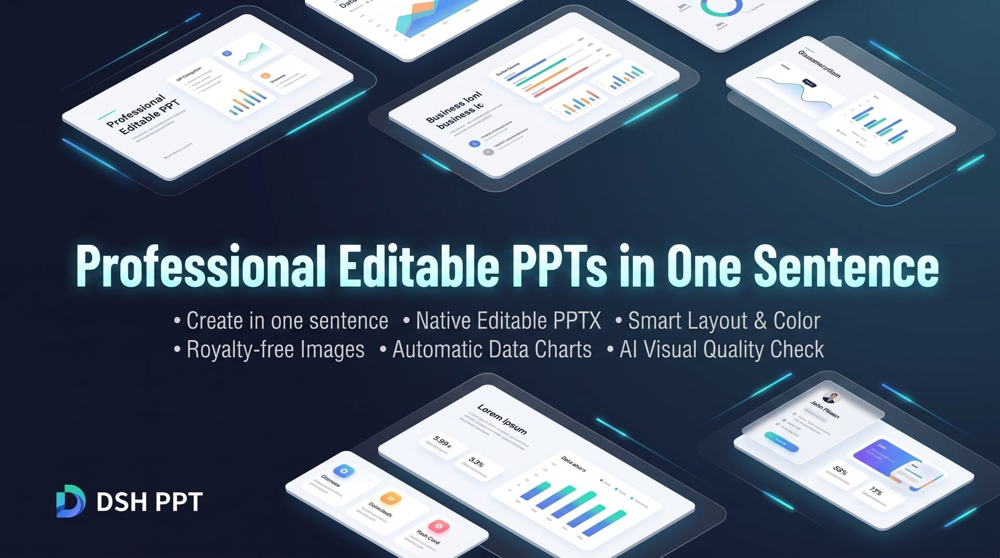

# DSH PPT · 一句话生成专业可编辑 PPT

**中文** | [English](README.en.md)

<p align="center">
  
</p>

<p align="center">
  
  &nbsp;
  
  &nbsp;
  
</p>
<p align="center">
  <strong>专为职场人打造的 DeepSeek 智能 PPT 创作助手</strong><br>
  <em>一句话生成 · 原生可编辑 PPTX · 智能排版与配色 · 免版权配图 · 自动数据图表 · AI 视觉审稿质检</em>
</p>

<p align="center">

[产品亮点](#产品亮点) · [快速上手](#快速上手) · [依赖与环境要求](#依赖与环境要求) · [内置主题库](#内置主题库) · [放映动效与字体](#放映动效与字体) · [使用场景](#使用场景) · [产物说明](#产物说明) · [多 Agent 协作流程](#多-agent-协作流程) · [常见问题](#常见问题) · [参考项目](#参考项目与致谢) · [开源协议](#开源协议)

</p>

## 源 fork 与上游

> **本仓库是 [yejiming/dsh-ppt](https://github.com/yejiming/dsh-ppt) 的维护 fork。**
>
> 当前的**默认安装源与插件头声明的上游**是 [mifeixiong/dsh-ppt](https://github.com/mifeixiong/dsh-ppt)：`package.json` 的 `repository` / `homepage` / `bugs` / `dsh.install`、`dsh-plugin.json` 的 `source.repository`，以及入口源码 `src/index.ts` / 构建产物 `lib/index.mjs` 里的头部声明，全部指向它。
>
> 本 fork 的改动只并入自己的 `main` 并推送，**不向上游提 PR**；上游仓库仅作为同步来源。
>
> 包名 `@yejiming/dsh-ppt` 与插件 id `io.github.yejiming.dsh-ppt` 保留上游标识，作为可直接替换（drop-in）的兼容名；本 fork 未发布到 npm，安装走 GitHub 规格。

## 产品亮点

做 PPT 总是耗费大量时间找模板、调对齐、排版面？市面上的 AI PPT 要么生成无法修改的“整页死图”，要么模板僵硬千篇一律。

**DSH PPT 让 PPT 制作回归内容本身：**

- ⚡ **两步出稿的快车道**：默认路线是 `ppt_outline` → `ppt_create`——大纲定内容与 Art Direction，插件按 `style.layout` 与主题配色确定性排版，不写 HTML、不开浏览器、不跑回渲，十页稿几百毫秒落盘。要手工版式时再切到精修车道（`html_create` + HTML 设计稿），需要自由矢量图形时走 SVG 车道（`ppt_create` 带 `svg_path`），三条车道共用同一个 PPTX 写入器与 OOXML 校验。
- 🧩 **SVG 车道：矢量稿直接变原生形状**：给 `ppt_create` 一份受限 SVG（`<path>`/`<polygon>`/`<rect rx>`/渐变/虚线/箭头/文本/图片），它把每个图元翻译成 DrawingML——自由路径是 `custGeom`，渐变是形状内 `gradFill`，箭头是 `headEnd/tailEnd`，文本按字体度量反解基线。不开浏览器、不栅格化，图元在 PowerPoint 里仍是可改的对象。格式、契约与边界见 [SVG 车道](docs/svg-lane.md)。
- 📝 **真正原生可编辑**：生成的不是整页死图，而是标准的 `.pptx` 文件。文字、图形、图表均可在 PowerPoint、Keynote 或 WPS 中随意二次修改与微调。
- ✏️ **改稿只改当页**：`ppt_update(pages=[...])` 只重排你改过的那几页，把它们的 OOXML 拼回原文件——其余页字节不动，包括你在 PowerPoint 里手改过的页。证据落在 `deck-patch.json`（逐页改前/改后哈希、媒体增删）。页数增减才退回整份重建，并在结果里标 `mode=full`。
- 📄 **与 `dsh-office-tools` 合成的文档车道**：PPT 模式不只出稿——宿主挂了 office bundle 时，同一会话里还多出 7 项文档工具：`word_*` 写讲稿与评审意见，`excel_*` 写数据表与口径对照，`ppt_read` 读既有 PPTX 的段落/表格/备注/元素几何。出稿仍只有一条路径（`ppt_create` 在预设作用域里遮蔽 office 的同名写入器）。见 [Office 文档车道](#office-文档车道和-ppt-一起交付附件)。
- 🎨 **专业级版式与审美**：告别套路化模板，AI 根据主题内容智能定制色彩搭配、字体层级与页面构图，呈现高级商务质感。
- 🎭 **12 套内置主题库**：每套主题都是一份经过校验的设计配方——配色取自 IBM Carbon、Tailwind、Radix、Microsoft Fluent 2 等公开色板，渐变取自 Color Hunt 与 uiGradients 的精选方案；字体只使用本机真能渲染的家族，并附带动效节奏、排印规则、签名手法、禁用习惯与逐页版式配方。另有 15 类生成式 SVG 纹样（同心圆、半调波点、HUD、刻度圆、条形码、波浪、点阵、多边形网格、等高线、经纬球、射线等）可按主题配色现取现用。调用 `ppt_themes` 直接选用，配色与渐变的文字对比度全部经 WCAG AA（≥4.5:1）实算验证，页面底色（含原生渐变）会原样进入 PPTX。
- 📈 **智能图表与精选配图**：自动搜索合规免版权商业配图，并根据数据自动绘制高品质图表，告别枯燥的大段纯文本。
- 👁️ **AI 视觉闭环审稿**：AI 会把做好的 PPT 真正“渲染并审阅一遍”，自动发现并纠正文字溢出、重叠与排版瑕疵，确保出片品质。
- ⚖️ **Refactoring UI 设计法则引擎**：以《Refactoring UI》的层级、色彩与排印法则为底、按幻灯片场景校准出的 9 条可机器判定规则（7 条直接对应书中条款，字号上限与字族上限 2 条是插件约定）——三级文字色、彩色底上不用灰字、4.5:1 / 3:1 对比度、每行字数、行高、字重下限、字号与字族上限、全大写标签字距，全部对逐页回渲结果实算。`html_create` 返回 `RUI_*` 诊断并写入 `design-validation.json`，另有 3 条判断项交给 AI 审稿；完整规则、阈值与审稿项见 [设计法则层](docs/design-rules.md)。
- ✨ **放映文字动画**：文字与图形可以按页配置入场动画——淡入、飞入、缩放、旋转、擦除等 29 种效果，支持按段落逐条构建、点击步编排与整页转场。
- 🔤 **任意本机字体**：不再局限于内置字体表，插件会枚举本机全部已安装字体（含 PANOSE、字距族、字符集与嵌入许可），也能把磁盘上的字体文件一键装进当前用户字体目录。
- 🔒 **本地安全与隐私保护**：所有制作与渲染过程在本地安全运行，素材来源与授权清晰记录，商业汇报更放心。

## 快速上手

### 1. 运行环境准备

- **DeepSeek Harness 0.2.0-rc.2 或更高版本**（本插件的 DSH 依赖声明为 `^0.2.0-rc.2`，与运行时版本一致；版本不匹配时插件会被拒绝加载）
- 电脑已安装以下任意办公软件（用于高保真渲染与视觉质检）：
  - **macOS**：Keynote 或 Microsoft PowerPoint
  - **Windows**：Microsoft PowerPoint
  - **通用 / Linux**：LibreOffice

### 2. 快速安装

本 fork 未发布到 npm，直接从 GitHub 仓库安装（`dsh plugin add` 接受 `github:` 规格）：

```bash
# 通过 DSH 插件管理器安装，web / headless profile 都适用
dsh plugin --profile web add github:mifeixiong/dsh-ppt
dsh plugin --profile headless add github:mifeixiong/dsh-ppt

# 需要可复现的安装时，钉到具体提交（本机三个 profile 就是钉提交的）
dsh plugin --profile web add github:mifeixiong/dsh-ppt#<commit-sha>
```

### 3. 开始创作

#### 方式一：Web 界面（推荐）
启动 Web 控制台后，新建会话并选择 **「PPT 模式」**，像和设计师沟通一样直接向 AI 提出需求：
```bash
dsh --profile web
```

#### 方式二：命令行极速生成
也可以直接在命令行输入一句话指令，快速生成整套演示文稿：
```bash
dsh --profile headless "为管理层制作一份6页的AI项目季度复盘与规划汇报"
```

#### 生成路径：先快后精
- **默认快车道**：`ppt_outline` 落 `outline.json`（含 `design-plan.json`）→ `ppt_create` 只传 `outline_path` 与 `output_path`，直接得到 `deck.pptx`。不产生 `deck.html`，也不需要浏览器。
- **精修车道**：需要非模板化版式或严格复刻品牌规范时，再写 HTML 走 `html_create` → `ppt_create(html_path, ...)`，`RUI_*` 告警在转 PPTX 前清掉。
- **质检闭环按需**：`ppt_image` → `read_image` → `visual-review.json` → `ppt_create(finalize_visual_review=true)` 只在要求验证时执行；快车道的 `report.json` 会把未执行的一层如实标成 `not_performed`，`overall_status` 停在 `unverified`。

## 依赖与环境要求

插件在 DSH 宿主进程里运行：生成、回渲与质检全部落在本机工作目录内，离开本机的只有图片检索和 `browser_visit`。下面每一项都对应源码里的真实行为，不是推荐配置。

### 必需

| 项目 | 要求 | 说明 |
| :--- | :--- | :--- |
| DeepSeek Harness | `0.2.0-rc.2` 或更高 | 插件声明 19 项 `@deepseek-ai/*` 对等依赖（其中 18 项为 `^0.2.0-rc.2`，`@deepseek-ai/cordis` 为 `^4.0.1`）。版本不匹配时插件被拒绝加载，PPT 模式与 22 项核心工具都不会挂载 |
| Node.js | `>= 20.19.0` | `package.json` 的 `engines.node` 声明 |
| 操作系统 | Windows / macOS / Linux | `package.json` 的 `os` 只声明 `win32`、`darwin`、`linux`；其它平台在插件加载期抛 `PPT_PLATFORM_UNSUPPORTED` |
| Chromium 系浏览器 | 本机已安装 Chrome、Chromium 或 Edge | HTML 校验渲染、`browser_visit` 与 HTML 预览截图都靠它。不需要 `playwright install`：插件只探测本机可执行文件，再用 `chromium.launch({ executablePath })` 显式启动 |
| `sharp` | 必需，但声明为可选（见下一节） | 图片元数据校验、回渲图归一化与联系表拼版 |

运行时 npm 依赖：

| 依赖 | 加载方式 | 用途 |
| :--- | :--- | :--- |
| `pptxgenjs` | 静态导入 | 把校验后的页面结构写成原生 PPTX |
| `fflate` | 静态导入 | 读写 PPTX/OOXML 的 ZIP 容器，含转场与文字动画的 XML 改写 |
| `fontkit` | 静态导入 | 解析字体文件、判定字形覆盖、生成字体子集 |
| `zod` | 静态导入 | 校验大纲、Art Direction 与质检载荷 |
| `schemastery` | 静态导入 | 声明插件 Config schema |
| `playwright-core` | 静态导入 | 驱动本机 Chromium 系浏览器 |
| `happy-dom` | 动态 `import()` | 只在 `html_create` 校验 HTML 时按需加载，不参与宿主启动 |

除 `happy-dom` 外，以上依赖全部在模块顶层静态导入。它们是**加载期硬依赖**：任何一项缺失都会让插件整体加载失败，而不是某个工具单独降级。

### 可选（增强能力）

**`sharp`：声明为可选，实际必需。** `package.json` 把它放进 `peerDependencies`，并在 `peerDependenciesMeta` 里标记 `optional: true`；但 `src/image-search.ts`、`src/python.ts`、`src/ppt-image.ts`、`src/quality.ts` 都在顶层静态 `import sharp from 'sharp'`，且没有 try/catch 兜底。缺失时插件同样整体加载失败，与这份可选声明矛盾。**请按必需依赖提供 `sharp`。**

**PPT 渲染器。** 缺了不影响出 PPTX，但会失去全部逐页回渲证据与视觉质检，`ppt_image` 返回 `not_available`。候选程序与回退顺序见下一节。

**Python 分析运行时。** 只有 `python_execute` 需要，用于绘制数据图表与图像处理。可执行文件默认为 Windows `python`、macOS / Linux `python3`，可用配置项 `pythonExecutable` 覆盖。必须先装好 `matplotlib`、`Pillow`、`opencv-python`：每次执行前会跑一次 `import matplotlib, PIL, cv2` 预检，失败抛 `PYTHON_DEPENDENCY_MISSING`。执行环境固定 `MPLBACKEND=Agg`，不弹窗。

### 外部程序与回退顺序

| 程序 | 用途 | Windows | macOS | Linux | 缺失时的行为 |
| :--- | :--- | :--- | :--- | :--- | :--- |
| Chrome / Chromium / Edge | HTML 校验渲染、`browser_visit`、HTML 预览截图 | `%ProgramFiles%`、`%ProgramFiles(x86)%`、`%LOCALAPPDATA%` 下的 `Google\Chrome\Application\chrome.exe`、`Chromium\Application\chrome.exe`、`Microsoft\Edge\Application\msedge.exe` | `/Applications/Google Chrome.app/Contents/MacOS/Google Chrome`、`/Applications/Chromium.app/Contents/MacOS/Chromium`、`~/Applications/Google Chrome.app/...` | `/usr/bin/google-chrome`、`/usr/bin/google-chrome-stable`、`/usr/bin/chromium`、`/usr/bin/chromium-browser`、`/snap/bin/chromium` | 抛 `BROWSER_NOT_READY`，诊断项 `browser` 为 `failed` |
| PowerShell | Windows 上驱动 PowerPoint COM 完成回渲 | `powershell.exe`、`powershell`、`pwsh.exe`、`pwsh` | — | — | Windows 的 `powerpoint` 后端不可用，回落 LibreOffice |
| Microsoft PowerPoint（桌面版） | 把 PPTX 回渲为逐页 PNG | 经 COM 启动；探测阶段不要求 `POWERPNT.EXE` 路径存在 | 经 AppleScript 启动，输出走 `screencapture` 截屏 | — | 该后端不可用 |
| Keynote | macOS 首选回渲：直接导出每页 PNG | — | `/Applications/Keynote.app`、`~/Applications/Keynote.app` | — | macOS 回落 LibreOffice |
| `osascript` | macOS 上驱动 Keynote / PowerPoint | — | `/usr/bin/osascript` | — | macOS 的 `keynote` 与 `powerpoint` 后端都不可用 |
| `screencapture` | macOS 的 PowerPoint 兜底：截屏放映窗口 | — | `/usr/sbin/screencapture` | — | macOS 的 `powerpoint` 后端不可用 |
| LibreOffice（`soffice`） | 跨平台回渲第一步：PPTX → PDF | `soffice.exe`、`soffice`，以及 `%ProgramFiles%`、`%ProgramFiles(x86)%`、`%LOCALAPPDATA%` 下的 `LibreOffice\program\soffice.exe` | `soffice`、`/Applications/LibreOffice.app/Contents/MacOS/soffice` | `soffice`、`libreoffice`、`/usr/bin/soffice`、`/usr/bin/libreoffice` | LibreOffice 后端不可用 |
| Poppler（`pdftoppm`） | 回渲第二步：PDF → PNG | `pdftoppm.exe`、`pdftoppm` | `pdftoppm` | `pdftoppm` | **整个 LibreOffice 后端不可用**：`soffice` 与 `pdftoppm` 必须同时存在 |
| Python | 数据图表与图像处理 | `python` | `python3` | `python3` | `python_execute` 抛 `PYTHON_DEPENDENCY_MISSING` |

浏览器探测顺序：配置项 `browserExecutable` → `playwright-core` 记录的浏览器路径 → 上表中的系统候选。

`backend=auto` 时的回渲顺序：

- **macOS**：`keynote` → `libreoffice` → `powerpoint`（截屏兜底，会额外提示动画与多显示器配置可能影响截帧）
- **Windows**：`powerpoint`（PowerPoint COM，由 PowerShell 驱动）→ `libreoffice`
- **Linux**：只有 `libreoffice`

所有候选都不可用时**不抛错**：`ppt_image` 返回 `not_available`，质检报告写入 `render_status: not_available` 并追加一条 `RENDERER_NOT_AVAILABLE` 警告，自动视觉层同步为 `not_available`。也就是说没有渲染器仍能产出 PPTX，但拿不到任何逐页回渲证据。

### 网络与隐私

只有两个出口：

| 操作 | 目标 | 凭据 | 失败时的行为 |
| :--- | :--- | :--- | :--- |
| `image_search` | 先请求 `api.openverse.org/v1/images/`，结果不足时补 `commons.wikimedia.org/w/api.php` | 不需要 API key | 不抛错：返回已拿到的结果并附 `degraded:unavailable` 之类的告警，同时给出三条替代路径（`read_image` 复用已冻结素材、`browser_visit` 从公开页面抓取、注入自定义 provider）。只有显式打开 `strictOnUnavailable` 才抛 `IMAGE_SEARCH_FAILED` |
| `browser_visit` | 模型指定的任意公网 http(s) 页面 | 不需要凭据 | 抛 `BROWSER_URL_BLOCKED`（URL 被判定为不可访问）或 `BROWSER_NOT_READY`（没有可用浏览器） |

`image_search` 的请求约束：15 秒超时、`redirect: 'error'`（不跟随重定向）、单响应上限 2 MiB、结果按查询缓存 10 分钟（降级结果不缓存，下次会真正重试）。

`browser_visit` 与 `image_search` 的候选图片 URL 共用同一套 SSRF 防护：只允许 `http` / `https`；拒绝带用户名或密码的 URL；只允许 80 / 443 端口；拒绝 `localhost`、`*.localhost`、`*.local`、`*.internal`；域名解析后逐个校验地址，环回、私有段、链路本地（含云元数据地址）、CGNAT、组播与保留段一律拒绝。浏览器上下文里的每个请求都经过同一条拦截路由，命中即中止。

HTML 侧没有外链：`html_create` 拒绝非本地资源引用和含远程 / data / file 资源的 CSS；PPT 模式里 `dsh-tool-web` 的 `fetch` 已关闭，该工具只做搜索。

其余能力——PPTX 生成、字体解析与子集化、回渲、自动质检、联系表拼版——全部在本机工作目录内完成。

### 平台差异矩阵

| 能力 | Windows | macOS | Linux | 不满足时的行为 |
| :--- | :--- | :--- | :--- | :--- |
| HTML 渲染与浏览器访问 | Chrome / Chromium / Edge 任一 | 同左 | 同左 | 抛 `BROWSER_NOT_READY` |
| PPTX 回渲（`auto`） | PowerPoint COM → LibreOffice | Keynote → LibreOffice → PowerPoint 截屏 | 仅 LibreOffice | 不抛错；`render_status=not_available` 加 `RENDERER_NOT_AVAILABLE` |
| LibreOffice 后端前置条件 | `soffice` 与 `pdftoppm` 同时存在 | 同左 | 同左 | 该后端不可用；Linux 上等于回渲能力归零 |
| Python 图表与图像处理 | `python` 加 matplotlib / Pillow / opencv-python | `python3` 加同上 | `python3` 加同上 | 抛 `PYTHON_DEPENDENCY_MISSING` |
| 系统字体目录 | `%SystemRoot%\Fonts`、`%LOCALAPPDATA%\Microsoft\Windows\Fonts` | `/System/Library/Fonts`、`/System/Library/Fonts/Supplemental`、`/System/Library/AssetsV2/com_apple_MobileAsset_Font7`、`...Font8`、`/Library/Fonts`、`~/Library/Fonts` | `/usr/share/fonts`、`/usr/local/share/fonts`、`~/.local/share/fonts`、`~/.fonts` | 配置项 `fontDirs` 只在这批目录之外**追加**；HTML 声明了未安装的批准主字体时抛 `PPT_DEPENDENCY_MISSING` |
| 字体安装（自定义字体） | 复制到 `%LOCALAPPDATA%\Microsoft\Windows\Fonts`，再用 `reg.exe` 写 HKCU 注册值 | 复制到 `~/Library/Fonts` | 复制到 `~/.local/share/fonts`，再尽力执行 `fc-cache -f` | 只影响自定义字体的可用性，不影响出片；Windows 上缺 `reg.exe` 时该步骤报错 |

### 对照：安装前自检

**Windows（PowerShell）**

```powershell
node -v
dsh --version

# Chromium 系浏览器：任一存在即可
Test-Path "$env:ProgramFiles\Google\Chrome\Application\chrome.exe"
Test-Path "${env:ProgramFiles(x86)}\Google\Chrome\Application\chrome.exe"
Test-Path "$env:LOCALAPPDATA\Microsoft\Edge\Application\msedge.exe"

# 回渲后端：PowerShell 加 PowerPoint，或 LibreOffice 加 Poppler
Get-Command powershell.exe
Test-Path "$env:ProgramFiles\Microsoft Office\root\Office16\POWERPNT.EXE"
Get-Command soffice.exe, pdftoppm.exe -ErrorAction SilentlyContinue

# Python 分析依赖
python -c "import matplotlib, PIL, cv2; print('python deps ok')"

# sharp（在插件被安装到的 profile 目录里执行）
node --input-type=module -e "import('sharp').then(() => console.log('sharp ok')).catch(() => { console.error('sharp missing'); process.exit(1) })"
```

**macOS**

```bash
node -v
dsh --version

# 浏览器：任一存在即可
ls -d "/Applications/Google Chrome.app" /Applications/Chromium.app 2>/dev/null

# 回渲后端：Keynote / PowerPoint，或 LibreOffice 加 Poppler
ls -d /Applications/Keynote.app "/Applications/Microsoft PowerPoint.app" 2>/dev/null
which osascript screencapture pdftoppm soffice

# Python 分析依赖
python3 -c "import matplotlib, PIL, cv2; print('python deps ok')"

# sharp
node --input-type=module -e "import('sharp').then(() => console.log('sharp ok')).catch(() => { console.error('sharp missing'); process.exit(1) })"
```

**Linux**

```bash
node -v
dsh --version

# 浏览器：任一存在即可
which google-chrome google-chrome-stable chromium chromium-browser

# 回渲后端：soffice 与 pdftoppm 必须同时存在
which soffice libreoffice pdftoppm

# Python 分析依赖
python3 -c "import matplotlib, PIL, cv2; print('python deps ok')"

# sharp
node --input-type=module -e "import('sharp').then(() => console.log('sharp ok')).catch(() => { console.error('sharp missing'); process.exit(1) })"
```

以上全绿后，PPT 模式的运行诊断（`platform`、`tools`、`browser`、`python`、`fonts`、`renderer`、`attachments`、`vision_model` 共八项）应当全部为 `ready`，其中 `vision_model` 还要求当前模型声明接受图片输入；任何一项 `failed` 都会在开工前被指出来。

## 内置主题库

插件内置 12 套设计主题。主题不是套壳模板，而是**一份可校验的设计配方**：配色、四个字体角色及其排印规则、逐页版式倾向、节奏限制、签名手法、禁用习惯，以及这套主题允许的装饰与渐变。它给 Art Direction 一个经过验证的起点，而不是替 AI 做设计——`concept`、`audience_effect`、每页的 `job` 与 `takeaway` 仍然由当前 Agent 按实际内容写。

| 主题 id | 名称 | 适用场景 | 底色（主 / 反色） | 强调色 | 渐变（仅海报页） |
| :--- | :--- | :--- | :--- | :--- | :--- |
| `carbon-blueprint` | 碳素蓝图 | 技术方案、架构评审、RFC 评审 | `#FFFFFF` / `#08131F` | `#0B57D0` | — |
| `slate-review` | 板岩复盘 | 季度复盘、经营分析、OKR 回顾 | `#F7F8FA` / `#0D1524` | `#8A5A17` | — |
| `midnight-raise` | 午夜融资 | 融资路演、战略汇报、董事会 | `#07111F` / `#F6F8FC` | `#7FB0FF` | Moonlit Asteroid |
| `paper-ink` | 纸墨 | 学术报告、白皮书、深度长文 | `#FAF7F0` / `#14110F` | `#A3164B` | Warm Paper |
| `editorial-serif` | 学刊 | 学术答辩、研究报告、政策解读 | `#F7F2EC` / `#191310` | `#8A3B12` | — |
| `telemetry-teal` | 遥测青 | 运维复盘、数据看板汇报、性能评审 | `#F7FAFA` / `#04191B` | `#0B6B66` | Deep Sea Space |
| `graphite-minimal` | 石墨极简 | 产品规格、内部对齐、工程文档 | `#FAFAF9` / `#1C1B1A` | `#A83A10` | — |
| `indigo-launch` | 靛蓝发布 | 产品发布、新版本宣讲、大会 Keynote | `#171334` / `#F3F1FF` | `#B6C2FF` | Indigo Bliss |
| `amber-academy` | 琥珀课堂 | 培训、工作坊、新人上手 | `#FDF9EE` / `#221505` | `#9C5209` | Sun on the Horizon |
| `crimson-brief` | 绯红简报 | 营销提案、立项申请、一页纸决策 | `#FFFDFC` / `#35060F` | `#B3163F` | Crimson Dusk |
| `fluent-azure` | 流蓝企业 | 企业汇报、客户方案、招标应答 | `#FFFFFF` / `#04223A` | `#0F6CBD` | Royal Azure |
| `moss-annual` | 苔绿年报 | 年度报告、ESG 披露、长期规划 | `#F7F9F1` / `#14200F` | `#3F6B2E` | Sage Wash |

配色不是拍脑袋定的：每套主题的色值都取自公开设计系统与公开色板（IBM Carbon、Tailwind、Radix、Microsoft Fluent 2、Color Hunt、uiGradients），并在代码里以 `palette_source` 记录了出处；渐变沿用 uiGradients 的灵感，但会按主题重新调色，重调过的会在 `note` 里注明来源并改名（如 Indigo Bliss、Crimson Dusk）。每套主题还带一个**反色强调色**——因为同一个强调色不可能同时在一个浅底和一个深底上都达到 4.5:1，这是颜色本身的物理限制，所以主题成对给出，逐页方案会指明该页用哪一个。

`ppt_themes` 返回的配方不再只有色号，还包含：

- `type_treatment`：标题/标签/正文的字距、标签大小写、数字是否等宽、正文每行字数——排印层级的可执行规则
- `signature`：这套主题的签名手法（例如「徽章式 240px 年份水印」「一条 2px 阈值线」），整套 deck 只重复这一件事
- `poster_moves`：封面/章节/引用/结束页的 3 条大胆排印方案（超大字、竖排单字、同词幽灵重影、字压色块、巨型数字、错位缩进），逐页方案会指定该页用哪一条，相邻海报页不重复
- `decoration` / `avoid`：允许的装饰动作与会破坏主题的坏习惯，两者都写成可执行的 CSS 语言
- `image_treatment`：摄影、截图与生成式素材的处理方式（双色调、裁切比例、叠加浓度），避免素材把版式带跑
- `gradients`：每套主题 0–2 条线性渐变，带角度、色标、所属色组、页数上限与纯色降级说明；只有封面、章节页、引用页与结束页可以用，每套 deck 最多 2 页
- `motifs`：这套主题可用的生成式装饰纹样（2–3 个 id + 放置建议）；再加 `motif_id` 调用会返回该纹样的自包含 SVG（base / inverse 两版）

页面底色写在 `.ppt-slide` 元素上，纯色与主题渐变都会导出为 **PPTX 原生幻灯片底色**（不是截图层）；因此 HTML 预览、PowerPoint 里看到的底一致，渐变也仍然是可编辑的矢量填充。

### 怎么用

```text
ppt_themes()                                              # 列出全部主题与场景标签
ppt_themes(scene="融资路演")                                # 按场景筛选
ppt_themes(theme_id="carbon-blueprint")                    # 读取完整配方
ppt_themes(theme_id="carbon-blueprint", page_types=[...])   # 取逐页视觉方案
ppt_themes(theme_id="carbon-blueprint", motif_id="square-grid")  # 生成纹样 SVG
ppt_outline(..., theme_id="carbon-blueprint", art_direction={...})
```

### 生成式装饰纹样

装饰不再只有圆、线和长方形。`ppt_themes(theme_id, motif_id=...)` 按主题配色生成 15 类自包含 SVG，返回 `svg_base`（浅色组）与 `svg_inverse`（反色组）：

同心圆 / concentric circles · 半调波点 / halftone dots · HUD 线条 / HUD lines · 刻度圆 / tick circle · 条形码 / barcode · 波浪纹理 / wave texture · 重复线条 / repeating lines · 点阵 / dot matrix · 多边形网格 / polygon mesh · 等高线 / contour lines · 常见图形 / common shapes · 嵌套多边形 / nested polygons · 经纬球 / wireframe globe · 方形网格 / square grid · 射线 / radial rays

生成原理与参考纹样工具一致：**确定性几何 + 主题调色板 + 可缩放 SVG**，不是随机贴图。每个纹样只使用 `circle / line / rect / path / polygon`，不含 filter、mask、pattern、foreignObject、script 或外链，因此能通过 HTML 白名单、进入 PPTX 时仍是矢量图形。每页最多一个纹样，放在角落、边缘或背景层，不压正文；一套 deck 2–3 页即可。

`ppt_outline` 带上 `theme_id` 后会做一致性校验，任何偏离都以告警列出，而不是静默通过：

- `THEME_PALETTE_DRIFT`：出现了主题未定义的颜色
- `THEME_ACCENT_REPLACED`：换掉了主题强调色
- `THEME_TYPOGRAPHY_REPLACED`：换掉了主题字体角色
- `THEME_ACCENT_DRIFT` / `THEME_FONT_DRIFT`：某页 `style.accent` 或 `style.font` 不在主题内
- `THEME_PLAN_MISSING`：选了主题却没给 `art_direction`，主题无从生效

### 配色来源与品牌色

12 套主题覆盖常见商务场景；要走客户品牌规范时，用 `browser_visit` 读取公开的品牌规范页取色，再按同一套纪律自建主题：正文与强调色对每一层底色都要 ≥4.5:1，深色页准备一个独立的反色强调色。`ppt_themes` 的返回值里带着这套规则，可以直接照着做。

### 设计约束（主题配方遵守，HTML 也必须遵守）

- 画布 1280×720，页边距水平 72px / 垂直 64px，内容区 1136×592，12 栏、列间距 24px，圆角只用 4 / 8 / 12px
- 字号层级：封面主标题 72px、页标题 44px、小节标题 32px、导语 26px、正文 24px、辅助 16px、指标数字 88px、代码 17px
- 排印：标题按 `type_treatment.display_tracking` 收紧字距，标签全大写并拉开到 `label_tracking`，正文受 `measure` 约束；同一页最多两种字族
- 海报页：封面、章节、引用、结束页必须执行 `ppt_themes` 返回的 `poster_move`，一套 deck 至少两种不同 move；正文页保持安静，不要把每页都做成「标题+方块」
- 装饰是封闭集合：1px / 2px 边框、圆角、色阶差、opacity、z-index、字号对比、栅格对齐、纯色或主题返回的 `linear-gradient` 背景
- 渐变是稀缺资源：只允许用 `ppt_themes` 为当前页返回的那一条，只出现在封面/章节/引用/结束页，每套 deck 最多 2 页，并且必须同时写与首个色标一致的 `background-color` 降级
- 页面底色写在 `.ppt-slide` 上，纯色与原生线性渐变都会进入 PPTX；不要用铺满整页的 `shape` 伪装底色
- 规则线（1px / 2px）与任何文字基线至少留 24px，永远不要穿过标题或副标题
- 文字旋转只允许纯 `rotate`（±8°、原点居中、不能缩放/斜切/平移），只用在短标签或单词上，整套 deck ≤ 2 处；它会以原生旋转进入 PPTX，预览与产物一致
- 允许 0.06–0.18 的低透明度中英文叠字作为背景层（真实文本、z-index 低于标题、每页最多一组），PPTX 中保留为可编辑文字
- 生成式纹样每页最多一个，放在角落/边缘/背景层，不压正文；用 `ppt_themes(theme_id, motif_id=...)` 返回的 SVG，不要手写复杂 SVG，一套 deck 2–3 页即可
- 投影（`box-shadow`）、`filter`、`clip-path`、`content` 一律禁止——立体感靠边框与色阶，这样 HTML 预览与 PPTX 产物才不会出现保真断层
- Refactoring UI 法则（机器可检部分）：一页最多 3 种文字色，层级用字重与颜色建立、不靠加装饰；一页最多 6 种字号、2 种字族（这两项为插件约定）；≤26px 的文字字重不低于 400
- 彩色底上不用灰字，也不用「白色 + 降透明度」凑弱化：按底色色相重新挑一个颜色，对比度至少 4.5:1（大字 3:1）；近白的纸色/近黑的墨色不算「彩色底」
- 正文每行 45–75 个拉丁字符（约 20–35 个中文字符），机器告警线放宽到 90 / 50 字符；多行正文行高 ≥1.3×；组与组之间的间距必须大于组内间距；全大写标签（≤20px）字距 ≥0.02em
- 以上 9 条规则由 `html_create` 对逐页回渲结果实算，违规以 `RUI_*` 出现在 `design_findings` / `warnings` 里，`strict_design` 下直接校验失败；另有 3 条人工判断项进 `visual-review.json` 的审稿清单。阈值与判定边界见 [设计法则层](docs/design-rules.md)

## 放映动效与字体

### 文字动画

`ppt_create` 接受可选的 `effects` 参数，为每一页声明放映效果。转场与入场动画都在 pptxgenjs 写出包之后、原子提交之前注入，只改写 `ppt/slides/slideN.xml`，其余部件逐字节保持原样；某一页没有声明动效就完全不动。

```jsonc
{
  "page": 1,
  "transition": { "type": "fade", "speed": "slow" },
  "animations": [
    { "target": "title-1", "effect": "fly-in", "direction": "up", "duration_ms": 600 },
    { "target": "body-1", "effect": "fade", "by_paragraph": true, "start": "after-previous" }
  ]
}
```

- `target` 是 IR 里的元素 id，也就是 PPTX 中该形状的名字。
- 入场效果共 29 种：`appear`、`flash-once`、`fade`、`dissolve`、`wedge`、`wipe`、`blinds`、`checkerboard`、`random-bars`、`box`、`circle`、`diamond`、`plus`、`split`、`strips`、`wheel`、`zoom`、`fly-in`、`crawl`、`peek`、`stretch`、`swivel`、`spiral`、`bounce`、`credits`、`float-in`、`grow-turn`、`rise-up`、`unfold`。
- 其中 `zoom`、`fly-in`、`crawl`、`peek`、`stretch`、`swivel`、`spiral`、`bounce`、`credits`、`float-in`、`grow-turn`、`rise-up`、`unfold` 属于**位移与缩放类**效果，文字会真正移动，而不只是显隐切换。
- `direction` 仅对渲染方向的效果有效：`wipe`、`fly-in`、`crawl`、`peek`、`blinds`、`checkerboard`、`random-bars`、`box`、`circle`、`diamond`、`plus`、`stretch`、`swivel`。
- `start` 取 `on-click`（默认）、`with-previous` 或 `after-previous`；一页的第一个动画总是开启一个点击步。
- 每页最多 24 条动画，同一元素在同一构建单位下只能出现一次；`by_paragraph` 会让它按段落逐条播放。

内部实现不靠规范散文，而以 PowerPoint 实际写出的时间线为准：`presetID` 的编号空间按 `presetClass` 划分，`presetSubtype` 是方向位掩码（`1`=上、`2`=右、`4`=下、`8`=左、`16`=入场、`32`=出场），真正决定渲染的是 `p:animEffect` 的 filter 与 `p:anim` 的初末值。

### 字体：自由选择与安装

`ppt_fonts` 有两个取样范围：

- `scope=registry`（默认）：插件内置的推荐字体表，并按角色给出确定性推荐。
- `scope=installed`：**本机实际安装的全部字体面**，每一项都带 PANOSE、pitch/family 字节、charset、字重、字形数、拉丁与中日韩覆盖，以及字体自身的嵌入许可位（`fs_type` / `embeddable`）。

`ppt_outline` 的 `title_font` / `body_font` 因此不再受内置表限制：**任何本机已安装的字体家族都可以直接指定**。只有当某个家族不在内置表里时，插件才会去扫描系统字体目录（要读取每个字体文件），因此常见路径没有额外开销。

把磁盘上的字体文件装进当前用户字体目录，之后就能在稿件里直接引用：

```jsonc
{ "scope": "installed", "install_path": "assets/fonts/BrandSans.ttf", "dry_run": true }
```

- 安装是**用户级**的，不需要管理员权限：Windows 写入 `%LOCALAPPDATA%\Microsoft\Windows\Fonts` 并登记 `HKCU` 下的字体项，macOS 写入 `~/Library/Fonts`，Linux 写入 `~/.local/share/fonts` 并尽力刷新 `fc-cache`。
- 先跑 `dry_run: true`，只会计算目标路径与家族名，不落盘、不写注册表。
- 返回值带 `uninstall_hint`，便于手工卸载。

关于把字体**嵌进 PPTX 文件本身**：PowerPoint 的原生嵌入部件（`ppt/fonts/*.fntdata`）是 EOT 容器，内部为 MicroType Express 压缩的 TrueType 数据，本插件不生成该格式。需要跨机器保真时，请用 `ppt_fonts` 把字体装到目标机器，或随产物分发字体文件后在目标机器安装。

## SVG 车道：矢量稿直接变原生形状

三条车道按"页面从哪来"区分：

| | 快车道（默认） | 精修车道（HTML） | SVG 车道（矢量） |
| :--- | :--- | :--- | :--- |
| 调用 | `ppt_outline` → `ppt_create` | `ppt_outline` → `html_create` → `ppt_create` | `ppt_outline` → 写 `deck.svg` → `ppt_create({svg_path})` |
| 页面来源 | 插件按 `style.layout` 确定性排版 | 模型写 1280×720 静态 HTML，浏览器量盒模型 | 模型写受限 SVG，静态解析成 DrawingML |
| 形状能力 | 矩形 / 圆角矩形 / 椭圆 / 纯色 | 盒模型、纯色、原生渐变底 | 自由路径、多边形、形状内渐变、虚线、箭头、精确文字定位 |
| 依赖 | 无浏览器、无回渲 | 浏览器内核 | 无浏览器、无回渲 |
| 适合 | 绝大多数汇报稿 | 非模板化版式、严格品牌规范 | 示意图、流程图、数据图形、海报化构图 |

`deck.svg` 的最小形态：

```xml
<svg xmlns="http://www.w3.org/2000/svg" viewBox="0 0 1280 720">
  <defs>
    <linearGradient id="hero" x1="0" y1="0" x2="1" y2="1">
      <stop offset="0" stop-color="#0B1B33"/><stop offset="1" stop-color="#1E4B8F"/>
    </linearGradient>
  </defs>
  <g data-page="1" data-background="#081120">
    <rect x="72" y="64" width="520" height="300" rx="12" fill="url(#hero)"/>
    <path d="M 760 420 L 900 480 L 1040 420" fill="none" stroke="#FFFFFF" stroke-width="4" data-tail="triangle"/>
    <text x="72" y="470" font-family="Liter" font-size="44" font-weight="700" fill="#FFFFFF">矢量标题</text>
  </g>
</svg>
```

页数必须与 `outline.json` 一致；不支持的图元（`filter`/`mask`/`clipPath`/`pattern`/`use`/`marker`）会带页号与元素 id 报错，而不是静默丢层。完整契约、映射表、诊断码与已知边界见 **[SVG 车道](docs/svg-lane.md)**，调查笔记见 **[ppt-master 实现调查](docs/ppt-master-notes.md)**。

## 改稿：只改当页

"把第 3 页的转化率改成 42%" 过去意味着重跑整份：`ppt_outline` 全覆盖 + `ppt_create` 重排全部页面，连你昨晚在 PowerPoint 里手工挪过的那页一起覆盖。

现在改稿走一条独立路径：

```
编辑 outline.json 的第 3 页  →  ppt_update(pages=[3])
```

`ppt_update` 用**同一个确定性写入器**按改后的内容重排这几页，只把这些页的 OOXML 拼回现有文件：

| 拼回的部件 | 处理 |
| :--- | :--- |
| `ppt/slides/slideN.xml` | 用新页面替换 |
| `ppt/slides/_rels/slideN.xml.rels` | 跟着替换，图片引用重指向 |
| `ppt/notesSlides/notesSlideN.xml` | 跟着替换（备注与页面同源） |
| `ppt/media/*` | 新图按内容哈希去重后加入；不再被任何页引用的旧图剪掉 |
| 其它所有部件 | **字节不变**，包括未改页、母版、主题、你在 PowerPoint 里的手改 |

结果里直接给出 `mode`（`patch` / `full`）、`updated_pages`、`unchanged_pages`、媒体增删，并写 `deck-patch.json`（逐页改前/改后 SHA-256）——"只改了第 3 页"是可以被核对的，不是口头承诺。

三条边界：

1. **页数不能就地增减**：outline 页数与稿件不一致时整份重建，结果标 `mode=full` 并在 `warnings` 里说明（插入/删除页属于重排，不是改稿）。
2. **HTML 精修车道**的页被快车道重排后会与相邻页风格不一致：`deck.html` 存在时会给出警告，要么整份 `ppt_create`，要么接受重排。
3. `report.json` 不会被悄悄改写：改稿后它仍描述旧字节，结果里 `report_status=stale` 并提示需要渲染证据时重跑 `ppt_image`。

## Office 文档车道：和 PPT 一起交付附件

一场汇报很少只有一份 PPTX：通常还要一份讲稿（.docx）、一张口径对照表（.xlsx），或者需要先读懂客户给的旧 PPTX。这些能力由 **`dsh-office-tools`** 提供，本插件不重复实现，而是把它们纳入 PPT 模式的**允许面**——宿主挂了那个 bundle，PPT 模式里就同时出现 7 项文档工具：

| 工具 | 作用 |
| :--- | :--- |
| `word_create` / `word_read` / `word_update` | 写、读、追加 Word：讲稿、评审意见、逐页备注的正式稿 |
| `excel_create` / `excel_read` / `excel_update` | 写、读、改 Excel：数据表、口径对照、预算与清单 |
| `ppt_read` | 读已有 PPTX 的段落、表格、备注、图片说明与逐元素英寸几何，返回文字线框；**只读、不渲染** |

**为什么是「继承」而不是「内置」**：DSH 的工具注册表一个作用域一张表，**同层**重复注册同名工具会直接失败（`tool "ppt_create" is already registered in this scope`），而**作用域注册会遮蔽全局同名工具**。所以组合方式是：

- `dsh-office-tools` 照旧由 profile 全局挂载，标准模式仍有完整的 8 项 Office 工具；
- PPT 模式的预设**不**挂第二份 office 工具，只把它们列进允许面（`PPT_OFFICE_TOOL_NAMES` / `PPT_MODE_TOOL_NAMES`）；
- `ppt_create` 在 PPT 模式里被本插件的出稿管线遮蔽——**出稿仍然只有一条路径**，不会出现两套 PPTX 生成器打架；office 的写入器只在其它预设里可用。

合并前这两半为什么没接上，取决于**组合顺序**（预设是在其行注册时就即时挂载的，而 deny 列表是那一刻全局视图的快照）：

| office bundle 的位置 | 现象 |
| :--- | :--- |
| 在本插件之后（本机 desktop profile 就是这样，`dsh-office-tools` 排在 bundles 末尾） | 工具一直可见可调，但审计把它们记成「外来工具」：每次 `tools/change` 一条警告，`tools` 启动诊断判 `failed` |
| 在本插件之前 | 进了 deny 列表被剪掉；deny 是按名字生效的，之后再注册同名工具也一直被拒 |

两种现象在把车道纳入允许面之后都消失了。

启用方式：把 `dsh-office-tools` 挂进 profile 的 `dsh.profile.bundles`（如 `github:kw78/dsh-office-tools`）即可。**它自带的 `enablePptTools` 必须保持 `true`**：`ppt_read` 与 `ppt_create` 是同一个注册函数里的两项，关掉它虽然能避开与 `ppt_create` 的争名，但会连 `ppt_read` 一起消失，车道变成 `partial (6/7)`。dsh-office-tools 自己的 README 建议「与专门的 PPT 插件共存时设成 false」，那是对没有作用域遮蔽的旧版 DSH 的说法，在本插件 + DSH 0.2 下不需要。

缺席时（例如 headless 只挂 dsh-ppt）没有文档车道，启动诊断写 `office document lane not mounted (no dsh-office-tools in this composition)`，状态仍是 ready；只挂了一半时写 `partial (n/7; missing …)`，`tools` 诊断降为 `degraded` 并在日志里点名缺失项。

两条要知道的边界：

1. 车道成员是**按名字**认的（注册表不暴露工具归属）。这七个名字从此不再可能出现在「外来工具」告警里，别的插件注册同名工具也会被当成车道；上游改名或改语义时车道会静默变 partial，只能靠上面的 `degraded` 和日志发现。profile 里 `dsh-office-tools` **没有 pin 到具体 commit**，升级上游属于这一栏的风险。
2. `ppt_read` 返回的是**文字与几何**，不是渲染证据——视觉判断仍以 `ppt_image` 生成的 PNG 为准；`ppt_read` 也永远不能改文件。

---

## 使用场景

| 场景分类 | 提示词示例 |
| :--- | :--- |
| 📊 **业务复盘 / 述职报告** | *"制作一份 6 页的 Q3 电商运营复盘 PPT，重点突出 GMV 增长、转化漏斗分析及下季度策略"* |
| 💼 **商业计划 / 方案提案** | *"为客户撰写一份关于企业私有化 AI 知识库的解决方案 PPT，8 页，商务科技风"* |
| 📢 **产品发布 / 功能推介** | *"围绕新上线的移动端应用设计一份产品发布宣讲 PPT，突出核心卖点与用户体验升级"* |
| 🎓 **培训分享 / 团队规范** | *"制作一份 5 页的敏捷开发入门与团队协作规范分享 PPT，风格轻松明快、条理清晰"* |

## 产物说明

每次任务完成后，系统会在 `ppt-output/` 目录下生成独立的项目文件夹：

- 📄 **`deck.pptx`**：最终生成的原生 PPT 文件，直接双击用 PowerPoint / Keynote / WPS 打开即可放映或自由编辑。
- 🖼️ **`preview/`**：各页面的高清截图预览，方便在手机、群聊或文档中快速预览与确认效果。
- 📁 **`assets/`**：PPT 中使用的图片素材与高清图表文件，并附带合规版权来源清单。

## 多 Agent 协作流程

一份 PPT 也可以由多个 agent 分工完成：一个搜图、一个找材料、一个出框架（大纲 + Art Direction）、主 agent 整合并交付。插件只提供固定的 22 项核心工具（宿主挂载 `dsh-office-tools` 时再加 7 项 Office 文档工具）与一套强校验的工件契约，分工由会话层编排。

- 🔍 **搜图 agent**：只往候选池写图片候选，不碰工件目录。搜索与落盘是两件事，冻结素材是主 agent 的活。
- 📚 **材料 agent**：只写带来源的研究笔记与结构化数据点。
- 🧭 **框架 agent**：只产出大纲与 Art Direction 载荷，不生成任何成品文件。
- 🎯 **主 agent**：独占 `ppt_outline` / `html_create` / `ppt_create` / `ppt_image`。默认按 `outline → pptx`（快车道）交付；需要定制版式时走 `outline → html → pptx`，需要验证时再补 `回渲 → 逐页审稿 → finalize`。

角色输入输出、写入边界（谁写 `outline.json`、谁写 `deck.html`、谁只产出候选清单）、依赖顺序与失败降级路径（含「图源不可用 → 退回零外链纯矢量设计」的真实案例）见 **[多 Agent 协作流程](docs/agent-workflow.md)**。

## 常见问题

<details>
<summary><b>Q: 生成的 PPT 在我的 Office / WPS 里打开会排版错乱吗？</b></summary>
不会。系统内置了多平台字体兼容适配方案（优先采用微软雅黑、苹方、思源黑体等主流系统字体），确保在不同设备与办公软件中打开时文字排版依然稳定美观。
</details>

<details>
<summary><b>Q: 可以把生成的 PPT 导出为 PDF 或直接全屏演示吗？</b></summary>
当然可以！生成的 <code>.pptx</code> 为标准演示文稿格式，支持在 PowerPoint、Keynote 或 WPS 中直接进入演讲者模式放映，或一键导出为 PDF / 演讲备注。
</details>

<details>
<summary><b>Q: 如果对生成的部分页面不满意，该如何调整？</b></summary>
有两种便捷方式：
1. **直接对话修改**：在会话中告诉 AI 调整意见（如“第 3 页换成柱状图对比”、“整体色系调整为商务蓝”）；
2. **本地自由编辑**：直接打开 <code>deck.pptx</code>，像普通 PPT 一样随意修改文字、替换图片或移动排版位置。
</details>

## 参考项目与致谢

本插件不是从零手搓：下表只列**真正进入产物**的第三方项目与被直接沿用的公开资料（在 `src/` 里可逐一核对），没列出的就是没用。

### 运行时依赖（确实在被 import）

| 项目 | 版本 | 在本插件里的作用 |
| --- | --- | --- |
| [PptxGenJS](https://github.com/gitbrent/PptxGenJS) | `4.0.1` | 生成原生可编辑 PPTX 的主引擎（文字 / 形状 / 图表 / 表格）；入场动画与转场在它写出包之后按 XML 级注入 |
| [fflate](https://github.com/101arrowz/fflate) | `0.8.3` | PPTX 包（zip）的解包与重写、deflate 压缩 |
| [fontkit](https://github.com/foliojs/fontkit) | `2.0.4` | 本机字体枚举、PANOSE / 字距族 / 嵌入许可解析 |
| [happy-dom](https://github.com/capricorn86/happy-dom) | `20.0.11` | HTML 幻灯片校验用的 DOM 实现；按需 `import()`，不让宿主启动变重 |
| [playwright-core](https://github.com/microsoft/playwright) | `1.62.1` | 只读研究页的浏览 / 点击 / 滚动与截图 |
| [sharp](https://github.com/lovell/sharp) | `^0.35.3`（可选 peer，复用 DSH 宿主单例） | 图像处理与规格化 |
| [zod](https://github.com/colinhacks/zod) / [schemastery](https://github.com/shigma/schemastery) | `4.4.3` / `3.18.0` | 工件契约与插件配置的 schema 校验 |

> 第三方依赖各自保留原始许可（PptxGenJS / fflate / fontkit / happy-dom / zod 为 MIT，playwright 与 sharp 为 Apache-2.0）；本仓库不复制、不分发它们的源码，只以依赖形式引用。

### 外部程序（非代码依赖，按平台回退）

| 来源 | 作用 |
| --- | --- |
| Microsoft PowerPoint / Apple Keynote | 高保真回渲与逐页视觉审稿的主后端 |
| LibreOffice（Windows / Linux 回退时另需 Poppler `pdftoppm`） | 跨平台回渲兜底 |
| Python 3（本机解释器，受 DSH sandbox 与超时约束） | 数据图表与图像分析 |
| Openverse、Wikimedia Commons | `image_search` 的免版权配图主源与兜底源 |

### 被直接沿用的公开设计资料

| 来源 | 用途 |
| --- | --- |
| IBM Carbon、Tailwind CSS、Radix Colors、Microsoft Fluent 2 的公开色板；Color Hunt 与 uiGradients 的公开配色/渐变 | 12 套内置主题的取色、渐变与排印依据 |
| WCAG 2.1 AA（≥4.5:1） | 每层底色 × 正文 / 强调色对比度的实算校验标准 |

### 宿主 SDK

`@deepseek-ai/*`（`cordis`、`dsh-agent-preset-registry`、`dsh-agent-preset`、`dsh-sandbox`、`dsh-subprocess`、`dsh-tools` 等）是 DeepSeek Harness 的宿主契约，以 `peerDependencies` 声明（`^0.2.0-rc.2`），不随本插件分发。

## 开源协议

本项目基于 [MIT License](LICENSE) 开源。

本仓库是 [yejiming/dsh-ppt](https://github.com/yejiming/dsh-ppt) 的 fork：原始著作权归上游作者，本 fork 的修改同样以 MIT 发布。内置主题的色值取自 IBM Carbon / Tailwind CSS / Radix Colors / Microsoft Fluent 2 的公开色板；第三方运行时依赖各自保留原始许可（见[参考项目与致谢](#参考项目与致谢)）。
